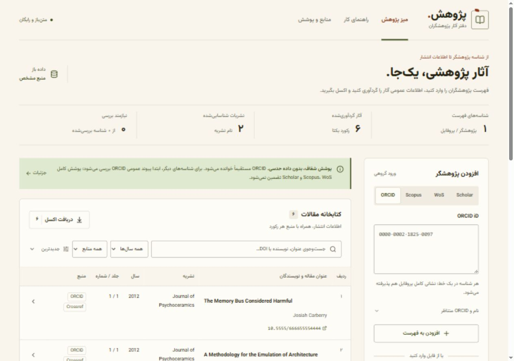

<div dir="rtl">

# پژوهش — دفتر آثار پژوهشگران

برنامه فارسی و راست‌به‌چپ برای تجمیع **فراداده آثار عمومی** با شناسه پژوهشگر، ورود دستی/اکسل، بررسی در جدول و خروجی اکسل. فونت وزیرمتن به‌صورت محلی بسته‌بندی شده است؛ در زمان اجرا از Google Fonts دانلود نمی‌شود. زمینه کاغذی روشن، سبز زیتونی و آجری.

**این برنامه دریافت تمام مقالات Scopus، WoS و Google Scholar را فقط با شناسه و به‌صورت رایگان تضمین نمی‌کند.** API پژوهشگران WoS پولی است؛ Scopus مجوز دسترسی می‌خواهد؛ خواندن مستقیم Scholar به صفحه عمومی مجاز محدود است. مسیر رایگان این پروژه: جست‌وجوی شناسه در خود ORCID و تأیید تطابق در پروفایل + Crossref + پیوند عمومی Wikidata + صفحه عمومی اول Scholar + ورود فایل‌های خروجی کاربر.



تصویر با دریافت زنده از پروفایل آزمایشی رسمی ORCID، `0000-0002-1825-0097` تهیه شده است؛ این پروفایل برای نمونه‌سازی است. [نمای موبایل](docs/mobile.jpg).

## قابلیت‌ها

- ورود گروهی ORCID، Scopus Author ID، WoS Researcher ID و Google Scholar User ID؛ پذیرش نشانی پروفایل.
- بررسی رقم کنترل ORCID، نرمال‌سازی ارقام فارسی و حذف شناسه‌های تکراری.
- ورود شناسه‌ها از XLSX، CSV و TSV، قالب اکسل آماده؛ تا ۵۰۰ شناسه.
- بازیابی تمام گروه‌های **آثار عمومی ثبت‌شده در ORCID**، چهار اثر در هر درخواست، بدون سقف مخفی تعداد مقاله.
- برای سه شناسه دیگر: جست‌وجو در ORCID و بررسی شناسه یا نشانی دقیق در پروفایل، هم‌زمان با Wikidata. خطای یکی از منابع مانع استفاده از دیگری نمی‌شود؛ پیوندهای متناقض انتخاب نمی‌شوند.
- برای Scholar بدون ORCID: دریافت مستقیم صفحه عمومی اول، تا ۱۰۰ اثر. محدودیت یا CAPTCHA و وجود صفحه‌های بیشتر صریح گزارش می‌شود؛ دریافت همه آثار تضمین نمی‌شود.
- ثبت ORCID متناظر کنار همان شناسه در فهرست و تلاش مجدد برای شناسه حل‌نشده؛ گزارش خطا خودکار باز می‌شود.
- ORCID متناظر اختیاری برای هر شناسه؛ این روش «نگاشت اعلام‌شده توسط کاربر» ثبت می‌شود.
- تکمیل با DOI دقیق در Crossref: نام نویسندگان، نشریه، جلد، شماره، صفحات، شماره مقاله، ISSN و ناشر؛ در صورت وجود اطلاعات.
- نمایش و فیلتر عنوان/نویسنده/DOI، سال و منبع، مرتب‌سازی، صفحه‌بندی، جزئیات رکورد و گزارش دریافت.
- توقف و ادامه از آخرین صفحه در همان نشست؛ با تغییر فهرست منبع، اجرای ناسازگار متوقف و تکرار از ابتدا درخواست می‌شود.
- ورود مستقیم فایل مقالات Scopus/WoS/Scholar؛ تا ۱۰٬۰۰۰ ردیف و ۵ مگابایت در هر فایل. فایل Excel قدیمی با پسوند XLS ابتدا باید به XLSX تبدیل شود.
- اکسل سه صفحه‌ای: مقالات فیلترشده، وضعیت پژوهشگران و گزارش کیفیت. DOI، کلید پایدار یا عنوان یکسان پس از یکسان‌سازی حروف، فاصله و نشانه‌گذاری، **فقط در محدوده یک پژوهشگر** ادغام می‌شوند. کامل‌ترین رکورد مبناست؛ خانه‌های خالی و منشأ داده از بقیه نسخه‌ها تکمیل می‌شوند. مقاله مشترک برای هر پژوهشگر یک ردیف جدا دارد.
- مقادیر فایل ورودی به‌عنوان رشته نوشته می‌شوند؛ رشته‌هایی که با `=` شروع شوند فرمول اجرایی اکسل نمی‌شوند.
- ذخیره در مرورگر اختیاری است. هیچ دیتابیس، سرویس AI یا اشتراک پولی نیاز نیست.

## پوشش واقعی شناسه‌ها

| شناسه | مسیر دریافت در پروژه | محدودیت |
|---|---|---|
| ORCID | خواندن مستقیم Public API | فقط آثار عمومی ثبت‌شده؛ کامل‌بودن پروفایل تضمین‌شده نیست |
| Scopus Author ID | جست‌وجوی تأییدشده ORCID + Wikidata یا ORCID کاربر یا فایل مقالات | دریافت مستقیم API اسکوپوس پیاده نشده است |
| WoS Researcher ID | جست‌وجوی تأییدشده ORCID + Wikidata یا ORCID کاربر یا فایل مقالات | API Researcher پولی استفاده نمی‌شود |
| Google Scholar User ID | جست‌وجوی تأییدشده ORCID + Wikidata؛ سپس صفحه عمومی اول یا فایل CSV | فقط صفحه عمومی مجاز؛ cstart و CAPTCHA دور زده نمی‌شوند |

نبودن پیوند عمومی به معنی نداشتن مقاله نیست. در ستون «منابع» همیشه منبع واقعی داده ثبت می‌شود؛ واردکردن شناسه Scopus، داده ORCID را به داده Scopus تبدیل نمی‌کند. «فهرست منبع دریافت شد» به خواندن فهرست همان منبع عمومی اشاره دارد. پیوند Wikidata ممکن است ناقص یا قدیمی باشد و بهتر است توسط کاربر بررسی شود. نام، تعداد استنادها، نمایه‌شدن در Scopus/WoS، چارک و ضریب تأثیر از روی نبود داده حدس زده نمی‌شوند.

## اجرا روی رایانه

Node.js نسخه ۲۲ یا جدیدتر:

```sh
npm ci
npm run dev
```

سپس [localhost:3000](http://localhost:3000) را باز کنید.

```sh
npm run typecheck
npm test
npm run build
npm start
```

آزمون مرورگر با یک سرور در حال اجرا:

```sh
npx playwright install chromium
npm run test:e2e
```

در محیط ویندوزِ محدود که ایجاد child process با pipe مسدود است، تنظیمات Next از TypeScript API و worker thread استفاده می‌کند. بررسی نوع همچنان فعال است.

## استقرار روی Vercel

1. در [Vercel New Project](https://vercel.com/new) با GitHub وارد شوید و مخزن `pajouhesh` را Import کنید. برای مخزن خصوصی، دسترسی همان مخزن را به Vercel بدهید.
2. **Framework Preset: Next.js**؛ **Root Directory: ریشه مخزن**. تنظیمات ساخت پیش‌فرض `npm run build` و نصب `npm ci` کافی است. Node.js را 22.x یا جدیدتر انتخاب کنید.
3. متغیر محیطی اجباری وجود ندارد. Deploy را بزنید.
4. پس از استقرار، دریافت یک ORCID عمومی و دانلود قالب و خروجی اکسل را آزمایش کنید.

[طرح Hobby ورسل](https://vercel.com/docs/plans/hobby) برای استفاده شخصی و غیرتجاریِ واجد شرایط رایگان است و سقف مصرف دارد. رایگان‌بودن کد به معنی مصرف نامحدود API یا میزبانی نامحدود نیست. برای استفاده سازمانی یا تجاری، شرایط میزبان و ORCID را جداگانه بررسی کنید. این پروژه هیچ منبع پولی را خودکار فعال نمی‌کند.

### تنظیمات اختیاری سرور

مقادیر را فقط در Environment Variables ورسل یا `.env.local` وارد کنید؛ با پیشوند `NEXT_PUBLIC_` نسازید.

| متغیر | کاربرد |
|---|---|
| `ORCID_ACCESS_TOKEN` | توکن read-public اختیاری برای سهمیه بهتر؛ درخواست ناشناس هم امتحان می‌شود |
| `CROSSREF_MAILTO` | ایمیل تماس اختیاری برای polite pool در Crossref |

هیچ کلیدی در رابط یا فایل اکسل ذخیره نمی‌شود. برنامه لاگ اختصاصی محتویات فایل ندارد؛ لاگ‌های زیرساخت تابع تنظیمات میزبان است. API عمومی است و احراز هویت ندارد؛ برای سایت شخصی محدود می‌توانید Deployment Protection یا قواعد Firewall ورسل را فعال کنید. به حافظه محلی یک instance برای محدودسازی سراسری تکیه نشده است.

## قالب فایل‌ها

**شناسه‌ها، قالب عریض**: ستون‌های `Name`, `ORCID`, `Scopus Author ID`, `WoS Researcher ID`, `Google Scholar ID`. در هر ردیف شناسه‌های همان فرد؛ یک ستون شناسه هم کافی است. ORCID در کنار سایر شناسه‌ها به‌عنوان نگاشت کاربر استفاده می‌شود. مقدار شناسه‌ها را در Excel با نوع Text ذخیره کنید.

**شناسه‌ها، قالب طولی**: ستون‌های `type`, `id`, `name`, `orcid`؛ نوع یکی از `orcid`, `scopus`, `wos`, `scholar`.

**مقالات**: حداقل `Title` یا `Article Title` یا «عنوان مقاله». ستون‌های اختیاری `Authors`, `Author Full Names`, `Source Title`, `Journal`, `Year`, `Publication Year`, `Volume`, `Issue`, `Number`, `Pages`, `DOI`, `ISSN`, `Publisher`, `URL` شناخته می‌شوند. مشخصات ترکیبی `Publication` در خروجی Google Scholar بدون تجزیه حدسی حفظ می‌شود. نام‌های فارسی اصلی نیز پشتیبانی می‌شوند. اولین صفحه فایل XLSX خوانده می‌شود.

فایل‌های مقالات در مرورگر تجزیه می‌شوند و به سرور آپلود نمی‌شوند. فایل کاربر انتساب اثر به پژوهشگر را مستقلاً اثبات نمی‌کند. برای تفکیک صاحبان مقاله، ستون `Researcher Name` یا «نام پژوهشگر صاحب شناسه» را اضافه کنید. شناسه‌های یک نفر با ORCID یکسان، یا نام کامل یکسان و بدون تعارض ORCID گروه‌بندی می‌شوند. برای افراد هم‌نام ORCID بدهید. عنوان‌های عمومی مثل Editorial به سال و ژورنال یکسان هم نیاز دارند؛ شباهت موضوعی عنوان‌های متفاوت باعث حذف نمی‌شود.

ستون‌های نام صاحب شناسه، نویسنده اول (☑ بله، ☐ خیر، — نامشخص) و مبنای تشخیص در اکسل آمده‌اند. تطبیق ORCID نویسنده بر نام اولویت دارد؛ نام کامل و ترتیب نویسندگان هم قابل استفاده‌اند. نام مخفف، ترتیب غایب یا منابع ناسازگار به «نامشخص» می‌انجامد. داده قدیمی ذخیره‌شده در مرورگر هنگام بازیابی به ساختار جدید تبدیل می‌شود.

## ساختار فنی

Next.js App Router / React / TypeScript / Zod / ExcelJS / Lucide / Vazirmatn.

- `app/api/collect/route.ts`: اعتبارسنجی HTTP و پاسخ خطای یکسان.
- `lib/sources.ts`: حل شناسه، خواندن صفحه آثار و تکمیل DOI.
- `lib/identifiers.ts`: نرمال‌سازی و اعتبارسنجی شناسه‌ها.
- `lib/identity-resolution.ts`: جست‌وجوی مستقل ORCID/Wikidata و تأیید تطابق دقیق شناسه در پروفایل.
- `lib/scholar.ts`: پردازش صفحه عمومی اول Scholar، تشخیص محدودیت و گزارش نتیجه ناقص.
- `lib/model.ts`: مدل مشترک و ادغام محافظه‌کارانه.
- `lib/files.ts`: ورود فایل و خروج اکسل با بارگذاری تنبل.
- `components/`: میز کار، جدول و جزئیات قابل استفاده با صفحه‌کلید.
- `tokens.css`: توکن‌های رنگ، قلم و فاصله؛ فونت وزیرمتن محلی.
- `tests/`: آزمون‌های منطق و مرورگر؛ پاسخ‌های ساختگی آزمون با داده واقعی استخراج‌شده اشتباه گرفته نمی‌شوند.

API فقط به میزبان‌های ثابت ORCID، Crossref، Wikidata و scholar.google.com درخواست می‌فرستد؛ ورودی URL آزاد برای fetch ندارد. زمان انتظار و تکرار محدود است. خطای تکمیل یک مقاله، فهرست سایر مقاله‌ها را حذف نمی‌کند. داده‌های تغییرکرده حین صفحه‌بندی با snapshot شناسایی می‌شوند. سرویس‌های عمومی ممکن است کند، محدود یا مسدود باشند؛ گزارش خطا و امکان تلاش مجدد در رابط وجود دارد.

## منابع و مجوزها

- [ORCID — Read data on a record](https://info.orcid.org/documentation/api-tutorials/api-tutorial-read-data-on-a-record/)
- [ORCID — Public API terms](https://info.orcid.org/terms-of-use/)
- [Crossref REST API](https://www.crossref.org/documentation/retrieve-metadata/rest-api/)
- [Wikidata Query Service](https://www.wikidata.org/wiki/Wikidata:SPARQL_query_service)
- [Elsevier — API Authentication](https://dev.elsevier.com/tecdoc_api_authentication.html)
- [WoS Researcher API — paid access](https://developer.clarivate.com/apis/wos-researcher)
- [Google Scholar Help](https://scholar.google.com/intl/en/scholar/help.html) و [robots.txt](https://scholar.google.com/robots.txt)
- [فیلدهای جست‌وجوی ORCID](https://info.orcid.org/ufaqs/which-fields-does-the-orcid-search-api-support/)
- [Vazirmatn — SIL Open Font License](https://github.com/rastikerdar/vazirmatn)

کد پروژه: MIT. مجوز و شرایط داده‌های منابع مستقل از مجوز کد است.

</div>
